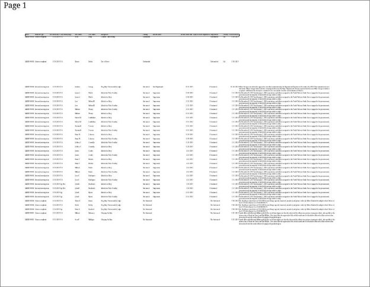

OK, so, I used a tool called pdf2txt.py provided by
[*pdfminer3*](https://github.com/gwk/pdfminer3/tree/master) to convert
our PDFs to html. Why? Well, because the html actually carries the pixel
position of everything in the file. E.g.

Based on this, I was able to write a script (in this directory)
[*ldw-convert7.py*](https://drive.google.com/file/d/1KDi0JuWb85Th7wllXEzeDeFjUQMkwfmw/view?usp=drive_link)
. Which works great on the 2019 file I was experimenting with
([*BPD-IAD-complaints-2019.html*](https://drive.google.com/file/d/14PkcQBRpSHlLkz27zINDOpqzpXSWUv6u/view?usp=drive_link)
). You can check out the csv file in this directory
([*BPD-IAD-complaints-2019.csv*](https://drive.google.com/file/d/1eSiRddC6t69LFlFBOck6kh-rDsNxGNRQ/view?usp=drive_link)
).

However, the files are not as consistent as I would have hoped. As a
result, I am gonna ask you to take a look at fields array and you will
probably have to adjust it for the pixels by file. I would probably just
clone the script per input pdf/html file and not try to get a script
that "works for all comers".

I have done the conversion to html for each of the pdfs that looked like
it was relevant but I am not 100% sure those were what you need. Hence
the instructions at the beginning of this doc.

I used chatgpt for a lot of this, but, as [*you can
see*](https://chat.openai.com/share/e77341b5-feed-4d31-a884-6a2c81cde5af)
it did NOT do a good job out of the box. So mostly i was asking for bits
and pieces to make coding faster.

Let me know if you have questions.
